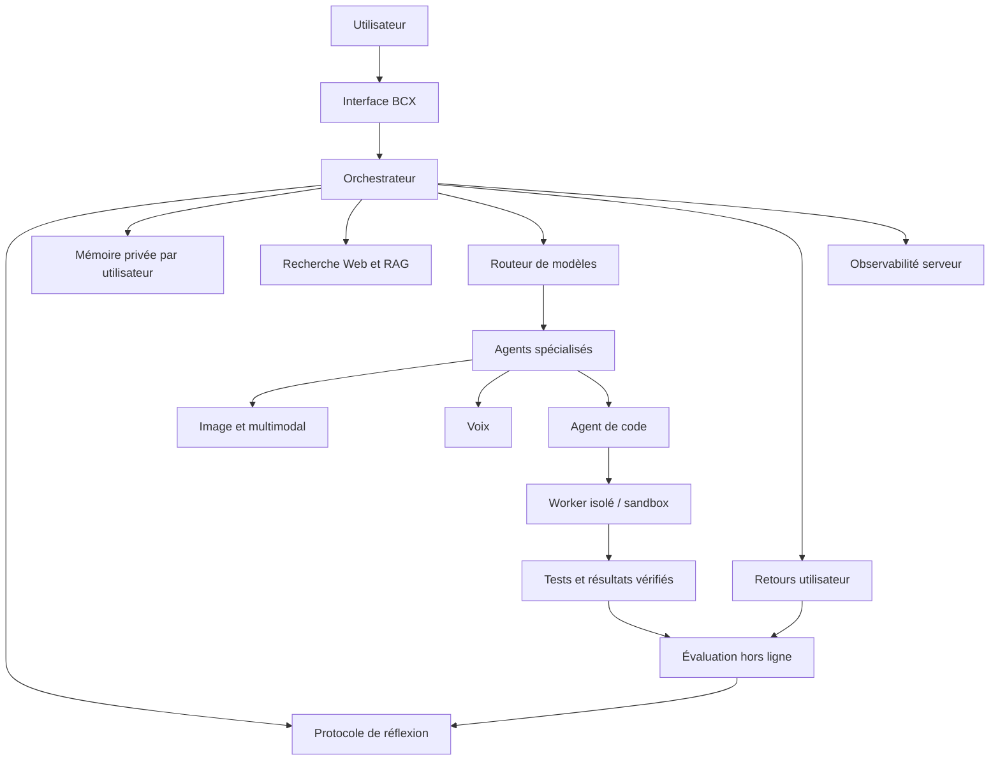

# BCX — Plan d'intégration des 10 capacités IA

## État réel des capacités

| # | Capacité | État dans le dépôt | Ce qui reste |
|---|---|---|---|
| 1 | Réflexion structurée | Consignes dans `src/lib/ai/prompt.ts` | Évaluer par jeux de tests |
| 2 | Mémoire contrôlée | Schéma SQL préparé | Appliquer la migration, puis créer l'UI CRUD et la récupération mémoire |
| 3 | Agent de programmation | Agent et plugins existants | Ajouter sandbox d'exécution séparée et flux de validation |
| 4 | Multimodal | Routes image et interface vocale présentes | Tester chaque format/provider en production |
| 5 | Recherche et RAG | Récupération de connaissances existante | Vérifier les sources/citations et ingestion de documents |
| 6 | Auto-vérification du code | Instructions et scripts check dans package.json | Runner isolé et résultats de tests réels |
| 7 | Retours utilisateurs | API feedback ajoutée | Appliquer migration, intégrer boutons 👍/👎 et analyser agrégé |
| 8 | Voix | Composant VoiceAssistant existant | Tester permissions, interruption et appareils mobiles |
| 9 | Agents spécialisés | Agent et plugins existants | Définir agents spécialisés avec permissions minimales |
| 10 | Contrôle / observabilité | Endpoint de capacités ajouté | Ajouter métriques serveur, alertes et vue admin protégée |

## Schéma d'architecture cible

## Contrats API préparés

- `GET /api/ai/capabilities`: état public non sensible des capacités et de leur configuration.
- `POST /api/ai/feedback`: retours authentifiés avec note `1` ou `-1`, catégorie et commentaire facultatif.
- `bcx_ai_memories`: mémoire privée par utilisateur, protégée par RLS.
- `bcx_ai_feedback`: retours de qualité, protégés par RLS.
- `bcx_ai_usage_events`: base de télémétrie sans accès client direct.

## Mise en service requise

1. Examiner et appliquer `supabase/migrations/202610200001_bcx_ai_capabilities.sql` dans le SQL Editor Supabase.
2. Déployer le code Next.js.
3. Connecter l'interface aux routes de feedback et de capacités.
4. Implémenter la gestion de mémoire (créer, consulter, supprimer) après authentification; ne jamais injecter automatiquement une mémoire non pertinente.
5. Pour exécuter du code, provisionner un worker éphémère isolé avec limites CPU/mémoire/temps, réseau désactivé par défaut et destruction après exécution. Ne jamais utiliser la route Next.js comme sandbox.
6. Ajouter des tests automatiques pour chaque fournisseur IA, permissions, limites, RLS et erreurs.
7. Vérifier le déploiement et les journaux réels avant d'annoncer que les capacités sont actives en production.

## Sécurité et données

- Ne jamais renvoyer de secret ou valeur de clé dans les endpoints.
- La mémoire appartient à l'utilisateur; suppression et export doivent être possibles.
- Les retours utilisateur n'entraînent pas de modification immédiate et non contrôlée du prompt système.
- Les actions d'écriture GitHub et les déploiements doivent conserver l'approbation explicite déjà prévue.
- Les états `secureSandbox: false` et `usageTelemetry: false` restent honnêtes tant que les systèmes correspondants ne sont pas opérationnels.
